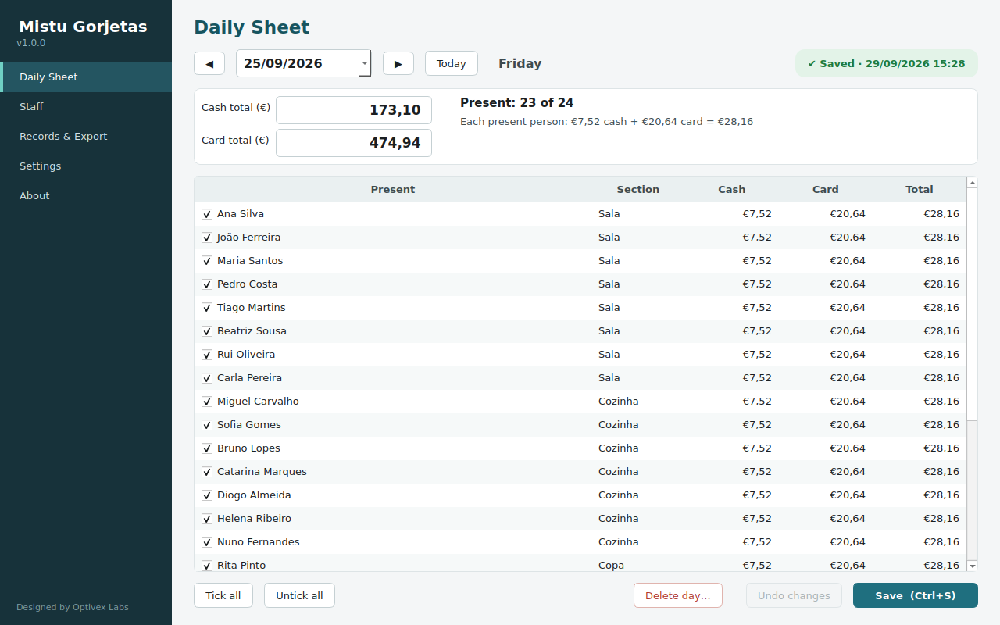
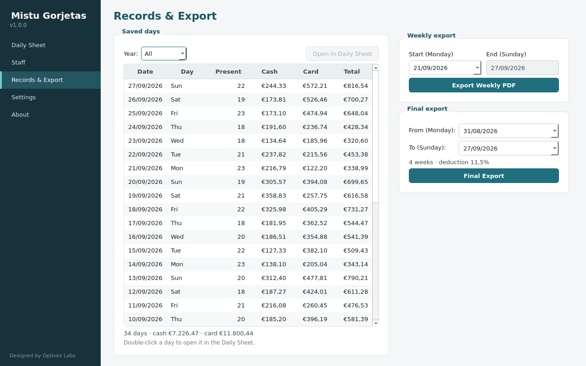
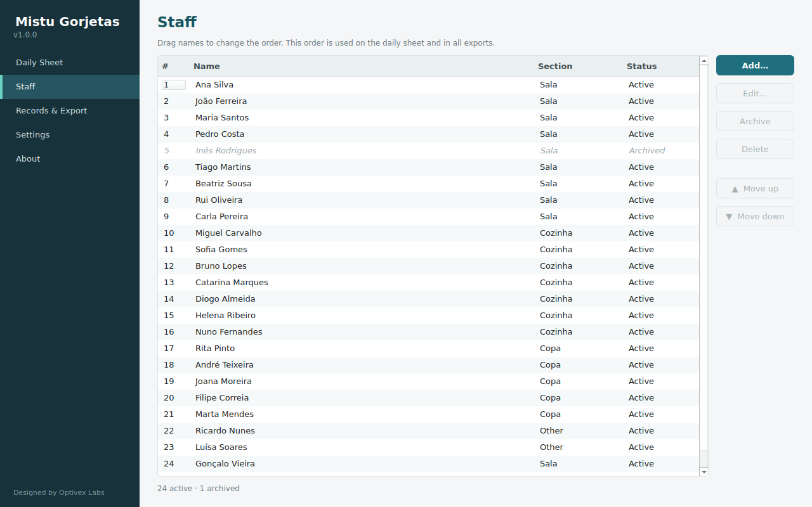
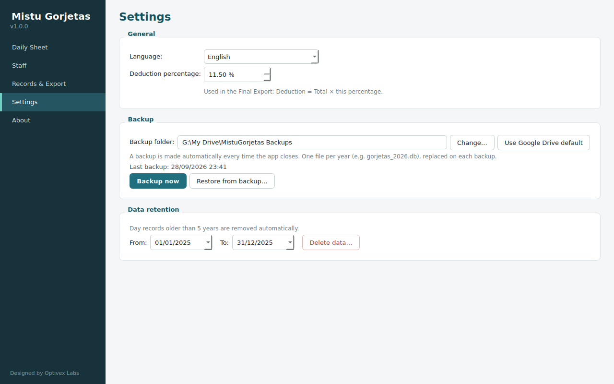
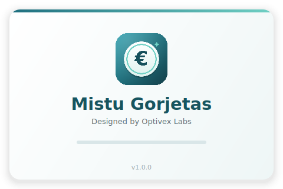
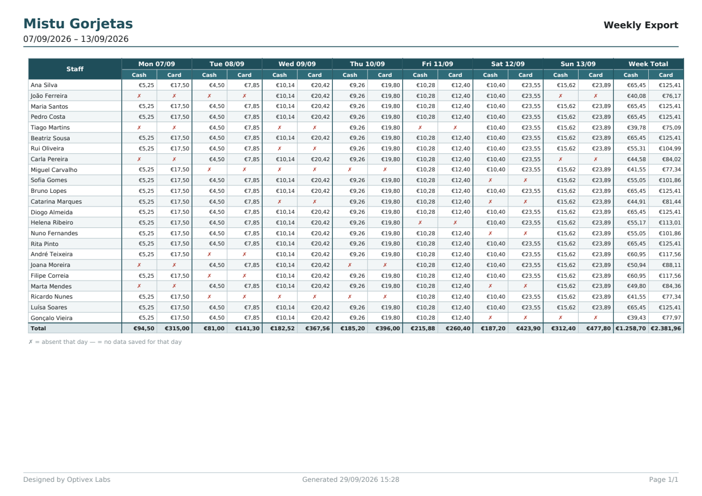
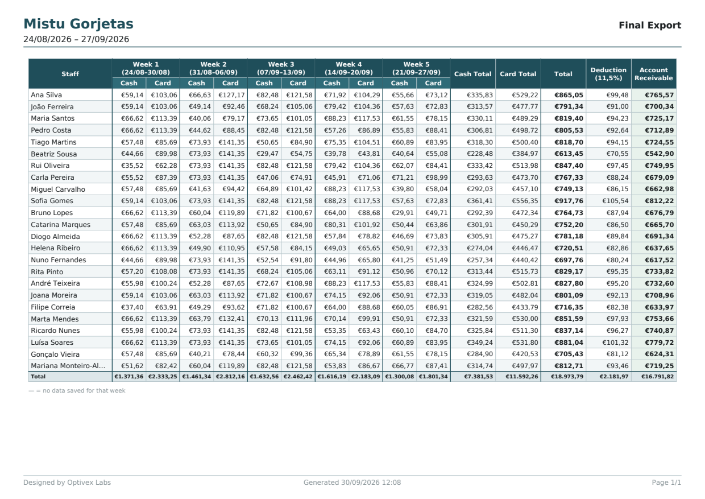

<p align="center">
  
</p>

<h1 align="center">Mistu Gorjetas</h1>

<p align="center">
  Desktop tip calculator for restaurants: record daily cash and card tips, split them fairly
  among the staff who worked, and export weekly and final payout reports as PDF.
  <br><br>
  <b>Windows 10/11</b> · Python 3.12 · PySide6 (Qt) · SQLite · ReportLab
</p>

<p align="center">
  
</p>

---

## Features

**Daily Sheet**
- Pick a date (today by default). All active staff are listed, ticked as present.
- Enter the day's **cash** and **card** tip totals. A live preview shows each person's share.
- Absent staff are greyed out. There is a clear *Saved / Unsaved changes / New day* indicator.
- Opening a saved date loads it for editing. **Delete day** removes one saved day.

**Staff**
- Add, edit, archive and restore staff members. Staff with history can't be deleted.
- Sections: Sala / Cozinha / Copa / Other.
- Drag to reorder. The order is used on the daily sheet and in every export.

**Records & Export**
- List of saved days with present count and totals. Double-click a day to edit it.
- **Weekly export (PDF):** pick a Monday; the Sunday is filled in automatically.
  Shows each person's cash/card per day, ✗ for absent, — for days with no data, and totals.
- **Final export (PDF):** any range of whole weeks (Monday to Sunday). Shows per-week cash/card,
  Cash Total, Card Total, Total, Deduction (x %) and Account Receivable for each person.
  Long ranges split evenly across pages (max 5 weeks per page).

**Settings**
- English / Português, switched instantly. This also sets the language of the PDFs.
- Deduction percentage.
- Automatic backup on every close to a folder of your choice (Google Drive by default),
  one file per year. *Backup now* and *Restore from backup* buttons.
- Records older than 5 years are removed automatically. Any date range can be deleted by hand,
  after an automatic backup.

**Installer & licensing**
- A single `MistuGorjetas_Setup.exe` wizard installs the app to Program Files and adds a desktop
  shortcut, a Start-menu entry and an uninstaller.
- Protected by an install key, and bound to the machine on first launch.

## Screenshots

| Records & Export | Staff |
|---|---|
|  |  |

| Settings | Loading screen |
|---|---|
|  |  |

| Weekly export (PDF) | Final export (PDF) |
|---|---|
|  |  |

## How tips are split

- All money is stored as **integer cents**. No floating point is used.
- Cash and card are split separately, **equally among the staff present** that day:
  `share = floor(total_cents / present_count)`.
- Shares are always rounded **down** to the cent. The sum of the shares can be 1–2 cents below
  the entered total, which is intended.
- Final export: `Deduction = Total × deduction %`, rounded half-up to the cent.
  `Account Receivable = Total − Deduction`.

## Getting started (development)

Requirements: Python 3.11+ (3.12 is used for the Windows build).

```bash
git clone https://github.com/tanjilh136/Gorjeta_Calculator.git
cd Gorjeta_Calculator
python -m venv .venv
# Windows: .venv\Scripts\activate    Linux/WSL: source .venv/bin/activate
pip install -r requirements.txt
python run_app.py
```

When run from source without an install key configured, activation is skipped.

To keep development data apart from real data, point the app to another folder first:

```bash
# Linux/WSL
export MISTU_DATA_DIR=/tmp/mistu-dev
# Windows
set MISTU_DATA_DIR=%TEMP%\mistu-dev
```

**Test data:** 25 staff and the last 5 full weeks, including absences, a closed day,
an archived staff member and a late joiner. This wipes the target database.

```bash
python seed_test_data.py --yes
```

**Tests:**

```bash
python -m unittest discover -s tests
```

> On WSL, Qt needs a few system libraries to open windows:
> `sudo apt install -y libxkbcommon-x11-0 libxcb-cursor0 libxcb-icccm4 libxcb-image0 libxcb-keysyms1 libxcb-render-util0 libxcb-shape0 libxcb-xkb1 libxcb-util1 libegl1`

## Building the Windows installer

Build on **Windows (64-bit)** with Python 3.12 and [Inno Setup 6](https://jrsoftware.org/isdl.php).

```bat
python -m venv .venv
.venv\Scripts\activate
pip install -r requirements-build.txt
python build.py
```

`build.py`:
1. Asks for the secret install key (hidden input, typed twice) and stores **only salted hashes**:
   PBKDF2-HMAC-SHA256 for the app, and iterated salted SHA-256 for the installer's password page.
   The key itself is never written to disk.
2. Runs PyInstaller (onedir), which produces `dist\MistuGorjetas\`.
3. Runs Inno Setup, which produces **`dist\MistuGorjetas_Setup.exe`**.

| Command | Purpose |
|---|---|
| `python build.py --keep-key` | Rebuild using the key hash already configured |
| `python build.py --set-key-only` | Only set or change the key hash |
| `python build.py --skip-installer` | Only run PyInstaller |
| `python build.py --iscc "C:\path\ISCC.exe"` | Use a specific Inno Setup compiler |

> ⚠️ After a build, `mistu_gorjetas/build_config.py` and `installer/key_hash.iss` contain the
> hashes of your key. Don't commit those versions. The repository keeps empty placeholders.

The version number is in `mistu_gorjetas/__init__.py`. The logo and icon are generated by
`tools/make_icon.py`.

## Installing on the client PC

1. Copy **only** `MistuGorjetas_Setup.exe` to the PC and run it.
2. Enter the install key on the password page and finish the wizard.
3. Open **Mistu Gorjetas** from the desktop and enter the key once more to activate it.
4. In Settings, check the backup folder and the deduction %, then add the staff.

Updates: run a newer `MistuGorjetas_Setup.exe` over the old one. All data is kept.

> The installer is not code-signed, so Windows may show *"Windows protected your PC"*
> (click **More info → Run anyway**). On PCs with **Smart App Control** enabled, unsigned apps are
> blocked until the installer is signed with a code-signing certificate.

## Licensing & machine binding

- On first launch the app asks for the key and writes an activation record to
  `%PROGRAMDATA%\MistuGorjetas\activation.dat`.
- The record holds a machine ID, a hash of Windows `MachineGuid` and the system drive's volume
  serial. It is encrypted with Windows DPAPI in machine scope, so it can't be read on another PC.
- On **every** launch the machine ID is recomputed and checked. A copied program folder or activation
  file locks the app and asks for the key again.

## Data locations

| What | Where |
|---|---|
| Database | `%APPDATA%\MistuGorjetas\gorjetas.db` |
| Log file | `%APPDATA%\MistuGorjetas\mistu_gorjetas.log` |
| Activation | `%PROGRAMDATA%\MistuGorjetas\activation.dat` |
| Backups | `<backup folder>\gorjetas_<year>.db` (default `G:\My Drive\MistuGorjetas Backups`) |

Uninstalling keeps the database and backups.

## Project structure

```
build.py                  Build script (key hash → PyInstaller → Inno Setup)
run_app.py                Entry point
seed_test_data.py         Test data generator
installer/                Inno Setup script (+ generated key hash include)
assets/                   Icon, logo, DejaVu fonts (used in PDFs)
docs/screenshots/         Images for this README
tools/make_icon.py        Generates assets/app.ico and assets/logo.png
tests/                    Unit tests
mistu_gorjetas/
  money.py                Cent parsing/formatting, split, deduction
  db.py                   SQLite schema and queries
  reports.py              Weekly / final export data
  pdf_export.py           PDF layout (landscape A4)
  licensing.py            Key check, machine ID, activation
  backup.py               Yearly backups and restore
  i18n.py                 English / Portuguese strings
  ui/                     Qt windows, pages and loading screen
```

## Credits

Designed by **Optivex Labs**.

PDF font: [DejaVu Sans](https://dejavu-fonts.github.io/) (Bitstream Vera license, see
`assets/fonts/LICENSE-DejaVu.txt`).
